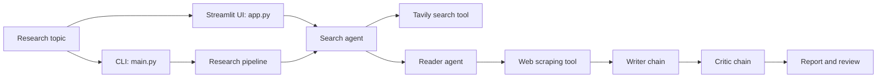

# LangChain Multi-Agent Research System

A research assistant that turns a topic into a structured report. It searches the web, extracts content from a relevant page, drafts a report, and asks a critic chain to review the result. The project includes a Streamlit interface and a Python pipeline entry point.

## Features

- Search the web with Tavily and collect up to five results.
- Extract readable page content using Trafilatura, Readability, and Beautiful Soup.
- Draft a report with an OpenAI chat model, including key findings and source URLs.
- Review the report and return a score, strengths, and suggested improvements.
- View intermediate research and download the final report as Markdown in the Streamlit app.

## Technology

- **Python 3.12+** — application runtime.
- **Streamlit** — web interface.
- **LangChain** — tool-enabled search and scraping agents, plus report-writing and review chains.
- **OpenAI** — `gpt-4o-mini` language model used by the agents and chains.
- **Tavily** — web search API.
- **Requests, Trafilatura, Readability, Beautiful Soup, and lxml** — page fetching and content extraction.
- **python-dotenv** — loads API credentials from a local `.env` file.

## Architecture

The app has four sequential research stages:



- `app.py` provides the interactive interface and displays the raw research, report, and critic feedback.
- `main.py` runs a sample topic through `src/pipelines/pipelines.py`.
- `src/agents/agents.py` configures the LangChain agents and the writer and critic chains.
- `src/tools/tools.py` defines the Tavily search and web-page extraction tools.
- `src/pipelines/pipelines.py` orchestrates the search, scraping, writing, and review stages for the Python entry point.

Both entry points use the shared agents and tools. The web UI runs the stages directly to show progress and intermediate results; the pipeline module provides the reusable Python orchestration function.

## Prerequisites

- Python 3.12 or newer
- Git
- An [OpenAI API key](https://platform.openai.com/api-keys)
- A [Tavily API key](https://app.tavily.com/)

## Installation

Clone the repository and enter its directory:

```bash
git clone https://github.com/omkarmali341/LangChain-Multi-Agent-Research-Syatem.git
cd LangChain-Multi-Agent-Research-Syatem
```

### Option 1: Install with `uv`

Install [uv](https://docs.astral.sh/uv/getting-started/installation/) if it is not already installed, then sync the locked project dependencies:

```bash
uv sync
```

Run commands in the project environment with `uv run` as shown below.

### Option 2: Install with `pip`

Create and activate a virtual environment:

```bash
python -m venv .venv
```

On Windows PowerShell:

```powershell
.\.venv\Scripts\Activate.ps1
```

On macOS or Linux:

```bash
source .venv/bin/activate
```

Install the application dependencies:

```bash
python -m pip install --upgrade pip
python -m pip install -r requirement.txt
```

## Configuration

Create a `.env` file in the project root and add your API keys:

```dotenv
OPENAI_API_KEY=your_openai_api_key
TAVILY_API_KEY=your_tavily_api_key
```

The `.env` file is git-ignored. Do not commit API keys or share them publicly.

## Run the application

Start the Streamlit interface:

```bash
uv run streamlit run app.py
```

If you installed with pip, use:

```bash
streamlit run app.py
```

Enter a topic in the browser to start the research workflow. The app displays search results and extracted content, then provides the generated report and critic feedback. The report can be downloaded as a Markdown file.

To run the sample Python pipeline instead:

```bash
uv run python main.py
```

With the pip environment activated, use `python main.py`. The sample topic is currently defined in `main.py`.

## License

See [LICENSE](LICENSE) for license terms.

## Contributing

Contributions are welcome. Open an issue to discuss a bug or proposed change, or submit a pull request with a clear description of what changed and how it was verified. Please do not include API keys or other secrets in contributions.
